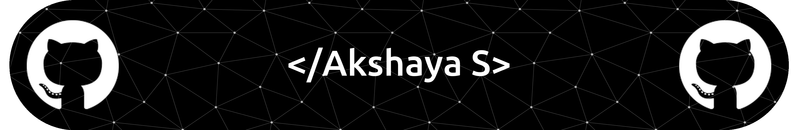
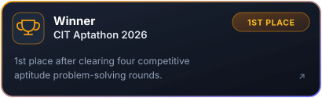
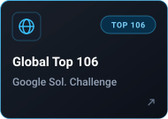
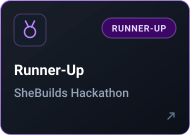
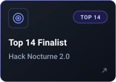
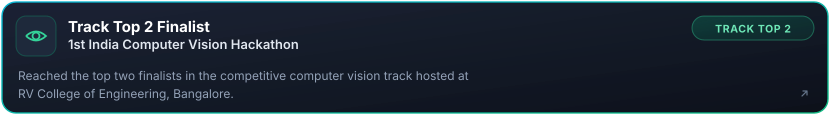

  
  
    
  

    

  
  &nbsp;
  
  &nbsp;
  
  &nbsp;
  
  &nbsp;
  

---

### 👨‍💻 About Me

  <samp>
    🎓 <b>B.Tech in CSBS @ Chennai Institute of Technology</b> &nbsp;|&nbsp; <b>CGPA: 9.24</b> 
    Building high-concurrency backend services, defensive AI firewalls, and optimized algorithms.
  </samp>

| ⚙️ `Backend Engineering` | 🛡️ `AI & Security` | 🧠 `Problem Solving` | 🌟 `Leadership` |
| :--- | :--- | :--- | :--- |
| Multithreaded REST APIs in Java, Python & Node.js | Intent escalation firewalls & Zero-Knowledge data privacy | 200+ LeetCode & SkillRack solutions | Event Lead @ Celestius • PR Lead @ IEEE WIE |

---

### 🛠️ Technical Skills

| Domain | Technologies & Tools |
| :--- | :--- |
| **Programming Languages** |      |
| **Backend & APIs** |      |
| **Databases & Storage** |     |
| **Frontend Development** |      |
| **AI & Emerging Tech** |     |
| **Dev Tools & Platforms** |      |

---

### 🚀 Featured Projects

| Project | Tech Stack |
| :--- | :--- |
| **[Kinship](https://github.com/Akshaya-csbs/Kinship)** ([Demo](https://kinship-production-9e78.up.railway.app/)) | Java 17, JDBC, MySQL, React, TypeScript, Tailwind CSS, Docker |
| **[NexusResponse](https://github.com/Akshaya-csbs/Nexus-last)** | React 19, TypeScript, Google Gemini API, Vertex AI, Firebase Firestore |
| **[Driftcatch](https://github.com/Akshaya-csbs/drift-final)** ([Demo](https://drift-catch.streamlit.app/)) | Python, Streamlit, Sentence Transformers, Scikit-learn, NLTK |
| **[MedSafe](https://github.com/Akshaya-csbs/MedSafe)** | React 18, TypeScript, Vite, Tailwind CSS, Client-side Cryptography |
| **[AptGuru](https://github.com/Akshaya-csbs/AptGuru)** ([Demo](https://aptguru.lovable.app/)) | React, TypeScript, Vite, Tailwind CSS, Supabase Edge Functions, LLM APIs |

---

### 📊 GitHub & Problem Solving Statistics

  <table border="0">
    <tr>
      <td align="center" width="50%">
        
      </td>
      <td align="center" width="50%">
        
      </td>
    </tr>
    <tr>
      <td align="center" colspan="2">
        
      </td>
    </tr>
  </table>

   

  

---

### 🏆 Achievements & Milestones

  
  

  
  

  

